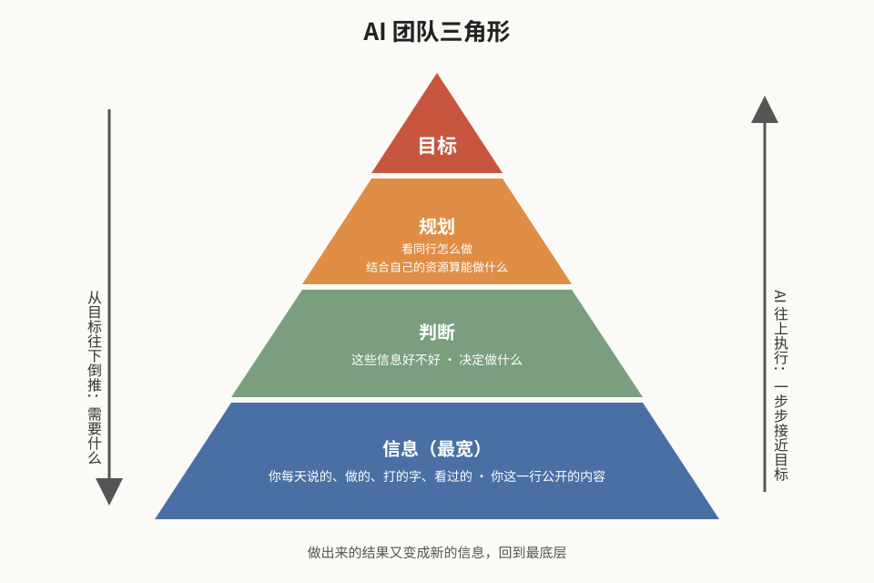
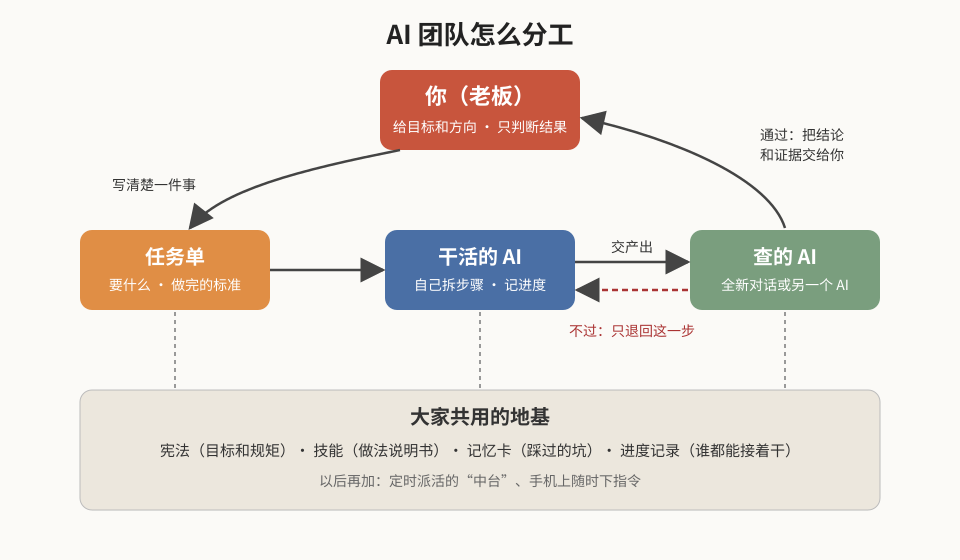

# 架构说明

## 一、三角形：系统为什么长这样

从上往下读是**倒推**，从下往上读是**执行**。

- **目标（顶）**：一句话、带数字、带期限。比如“半年内每周稳定做出 3 份客户方案”。没有目标，AI 再多也只是在忙。
- **规划**：看你这一行做得好的人是怎么做的，再结合你手上的资源（信息、钱、能力、时间），算出你现在能做什么、先做什么。
- **判断**：底下收上来的信息，大部分没用。判断这一层负责挑出有用的那一两成，决定做什么、不做什么。**这一层最该留给你自己**，AI 可以帮你整理和打分，拍板是你。
- **信息（底，最宽）**：你每天说的话、做的事、打的字、看过的东西，加上你这一行所有公开的内容。人和 AI 的能力其实都差不多，真正拉开差距的是信息的收集和获取。

两条规矩：

1. **从尖往下倒推**：每加一个 AI、一个技能、一个定时任务，先问它服务三角形的哪一层、最后能不能挂到目标上。挂不上的不加。
2. **结果回到底层**：做出来的东西（文档、作品、数据）又变成新的信息，下一轮判断用得上。这样系统会越用越准。

## 二、分工：谁干什么

- **你（老板）**：给目标和方向，写任务单（或者让 AI 帮你写），最后只判断结果好不好。中间过程不用盯。
- **干活的 AI**：拿到任务单，自己拆步骤、自己干、自己记进度（见技能“拆活干活”）。
- **查的 AI**：一个**没参与制作**的 AI 来检查。可以是同一个工具开一个全新对话，也可以是另一家的 AI（见技能“做的人不是查的人”）。不过只退回出错的那一步，不推倒重来。
- **地基**：宪法、技能、记忆卡、进度记录，所有 AI 共用。换一个 AI 来接手，读完地基就能接着干（见技能“接管手册”）。

## 三、这套和“跟 AI 聊天”有什么不同

| | 跟 AI 聊天 | AI 团队 |
|---|---|---|
| 你在干什么 | 在旁边等、一句句调 | 交代完就走，回来看结果 |
| 规矩放哪 | 每次重新说 | 写在宪法和技能里，一次写好反复用 |
| 谁来查 | 你自己 | 另一个 AI 先查，你最后判断 |
| 中途换人 | 从头讲一遍 | 读进度记录接着干 |
